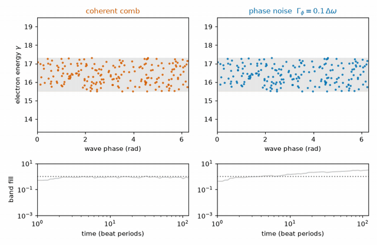
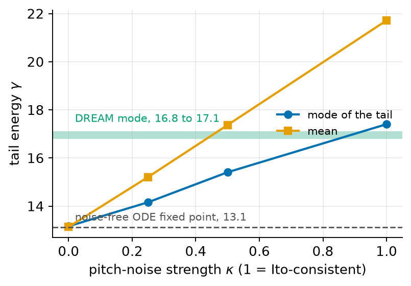
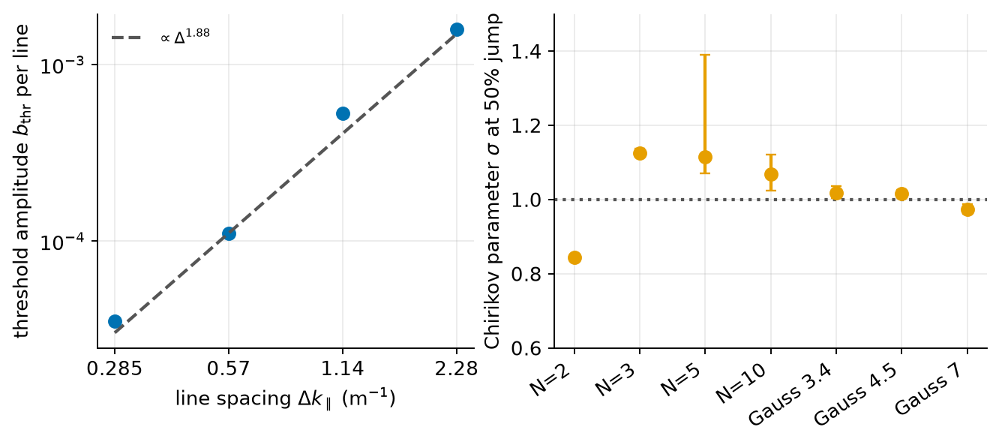
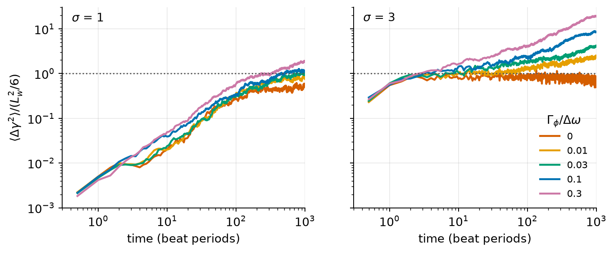
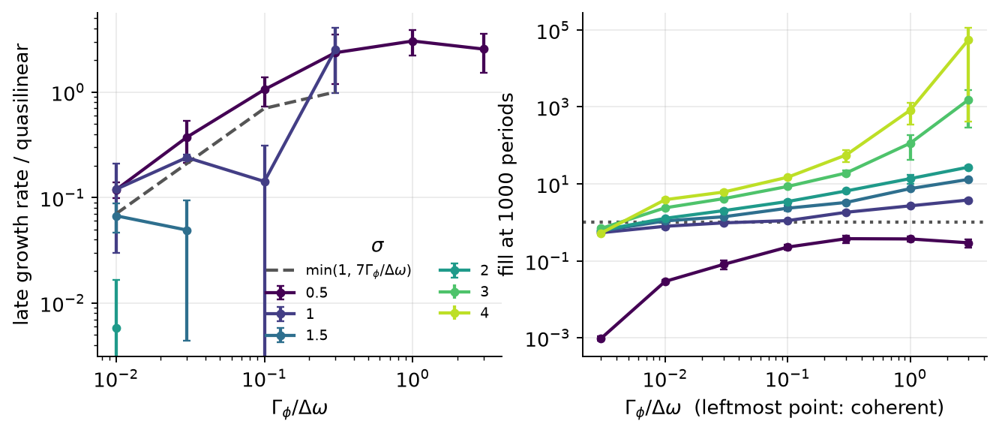
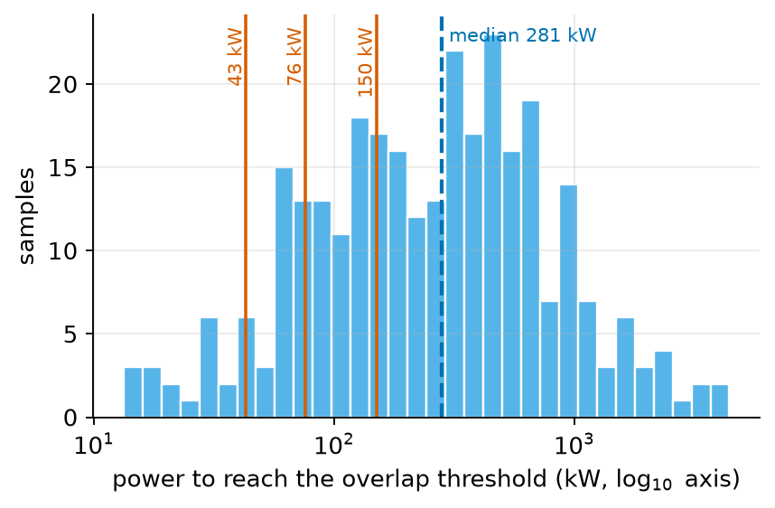
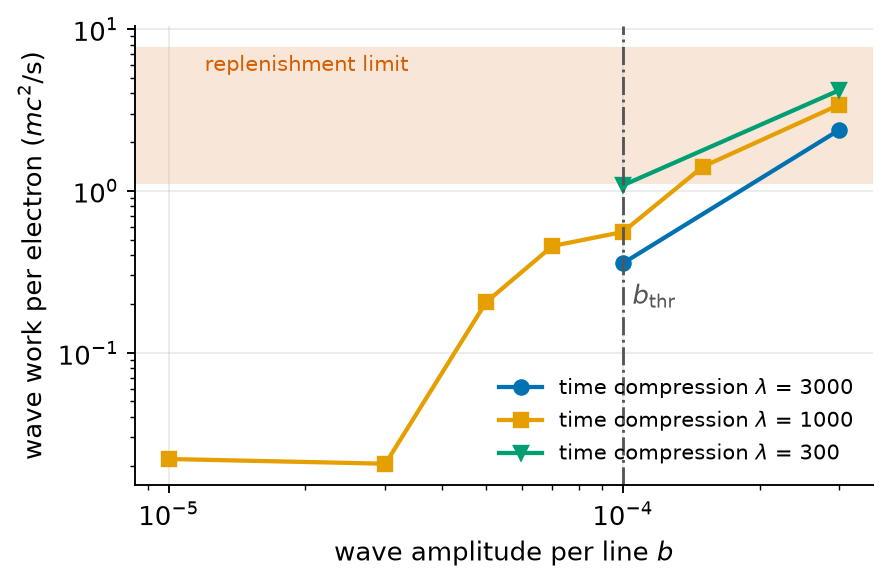

<p align="center">

</p>

<p align="center">
Can a launched comb of helicon waves scatter runaway electrons? Studies of runaway-electron suppression with radio-frequency waves, built on the differentiable particle-in-cell code <a href="https://github.com/uwplasma/JAX-in-Cell">JAX-in-Cell</a>.
</p>

<p align="center">
<a href="https://github.com/rogeriojorge/runaway-rf-pic/actions/workflows/tests.yml"></a>
<a href="LICENSE"></a>
</p>

The repository holds four runnable JAX-in-Cell studies (a no-RF runaway baseline, differentiable RF control, the minimum supplied RF energy, and the RF source ledger) and the analysis behind a note on how a comb of toroidal helicon lines scatters runaways at DIII-D parameters. The movie above follows 200 electrons across a ten-line comb at Chirikov parameter 3. With coherent lines the electrons fill part of the band and stop. With a small phase noise on each line they keep diffusing. The write-up is [`paper/note.pdf`](paper/note.pdf).

## Install

```bash
git clone https://github.com/rogeriojorge/runaway-rf-pic
cd runaway-rf-pic
python -m venv .venv && . .venv/bin/activate
pip install -e ".[test]"
```

Python 3.10 or newer. JAX-in-Cell is pinned to one commit in `pyproject.toml`. The tests run each study in its quick preset and check the collision kernel against the Connor and Hastie critical force.

## Run

```bash
pytest
python studies/runaway_baseline/runaway_baseline.py
python scripts/make_figures.py     # redraws every figure below from results/
python scripts/make_movie.py       # reruns the reduced model for the movie, a few minutes on a CPU
```

Each study runs in 10 to 25 s on a laptop CPU, with the converged settings marked `research` in the scripts. Every study has a short README in its folder.

## Baseline

At B = 2 T and E = 5 mV/m (E/E_c = 6.5) the runaway tail of the 0D3V runs settles in tens of seconds to a mode at gamma = 17.7, against 17.0 from DREAM. The synchrotron fixed point at gamma = 13.1 belongs to the noise-free test-particle equation. Adding pitch noise moves the mode from 13.1 to 17.4, so the fixed point does not bound the kinetic tail.

<p align="center"></p>

## Overlap threshold

A single coherent line at DIII-D amplitudes is trapping-limited and scatters less than quasilinear theory predicts. For a comb the transport jumps when neighbouring resonance islands overlap, at a Chirikov parameter sigma close to 1. For the toroidal comb of ten lines this happens at an amplitude b = dB/B of about 1e-4 per line, and the threshold scales with the line spacing to the power 1.9. Collisions and radiation reaction do not move it, since the effective collision frequency is about 1e-6 of the bounce frequency.

<p align="center"></p>

## Bounded chaos

Above the threshold the motion of a coherent comb is chaotic but confined. The mean squared energy change rises quickly, fills 0.5 to 0.7 of the band and stops, and it stays there to 3000 beat periods. Overlap sets how fast the band fills, from 266 beat periods at sigma = 1 to a single period at sigma = 3, and not whether growth continues. The scattering therefore lasts 1 to 10 microseconds after the comb is switched on.

<p align="center"></p>

## Sustained scattering needs a linewidth

Independent random-walk phase noise of half-width Gamma on each line turns the plateau into steady diffusion. The late growth rate relative to quasilinear theory is zero for the coherent comb, switches on at Gamma/Delta-omega of 0.01 to 0.03 and reaches the quasilinear value near 0.1 to 0.3. A rough law is min(1, 7 Gamma/Delta-omega), which means a coherence time of a few beat periods. The map is good to a factor of 1.5 to 2 per cell, with three seeds of 64 particles.

<p align="center"></p>

## DIII-D

With cold-tensor Landau and transit-time damping over sampled profiles, the launched power of 43, 76 and 150 kW gives a wave amplitude of 0.39, 0.52 and 0.69 of the threshold (median), so sigma is 0.6 to 0.8. The probability of exceeding the threshold is 6, 17 and 24 percent. The median power needed is 280 kW, with a 75 to 730 kW range. A phase-locked klystron has a linewidth of Hz to kHz, far below the 0.01 needed, so the comb is coherent and below overlap. Only parametric-decay broadening or deliberate frequency modulation would reach the sustained regime, and the model does not explain the observed hard X-ray reduction without one of them.

<p align="center"></p>

## Pinning is refuted

One might expect runaway absorption to hold the wave amplitude at the threshold. The validated quasilinear absorption is 9.5e6 per second per 1e15 resonant electrons per cubic metre, 5 to 12 times below the earlier estimate, and the wave flattens the distribution in about a microsecond. Absorption is then limited by how fast electrons are replenished, about 7 kW per 1e15 m^-3, far below the threshold power near 240 kW. The overlap threshold is an onset and not an attractor.

<p align="center"></p>

## Predictions

Two measurements can decide the question. Frequency modulation of 1 to 3 MHz at fixed power should lower the power needed for a given hard X-ray reduction, because it supplies the missing linewidth (1 MHz is about 0.04 of the line spacing). Doppler backscattering at the resonant location should show the pump linewidth and a sideband amplitude near b = 1e-4 per line at threshold power. After the klystron stops the wave should ring down in about 3.7 microseconds, and synchrotron or ECE emission should rise by 15 to 25 kW per 1e15 m^-3 resonant electrons above onset.

The limits are in the final section of the note: one ten-line comb, a uniform plasma, cold-tensor damping, a runaway distribution of the P1 type, and a map accurate to a factor of 1.5 to 2.

## Layout

| Path | Content |
|---|---|
| `studies/` | The four JAX-in-Cell studies, each with a README |
| `scripts/` | `make_figures.py` and `make_movie.py` for the figures and movie above |
| `tests/` | The studies in their quick presets and a critical-force check |
| `paper/` | LaTeX note and compiled PDF |
| `results/` | Scripts, notes and small data for each stage of the helicon study |
| `docs/` | [Numerics note](docs/runaway_rf_control.md), [research log](docs/research_log.md), [literature survey](docs/literature/INDEX.md), [reference notes](docs/notes/REFERENCES.md) |

The scripts in `results/` are archival. They ran against earlier JAX-in-Cell branches and are not covered by the tests. Paper PDFs, third-party code runs, profiling data and raw arrays above 600 kB are not included.

## Citing

If you use this repository, please cite JAX-in-Cell, the note, and the repository:

```bibtex
@article{ma2025jaxincell,
  title   = {JAX-in-Cell: a differentiable particle-in-cell code for plasma physics applications},
  author = {Ma, Longyu and Jorge, Rogerio and Lu, Hongke and Tran, Aaron and Woolford, Christopher},
  journal = {arXiv:2512.12160},
  year    = {2025}
}
```

The note is `paper/note.pdf` (R. Jorge, review note on JAX-in-Cell runaway-electron RF control, 2026), and the code is at https://github.com/rogeriojorge/runaway-rf-pic.

## License

MIT, see `LICENSE`.
