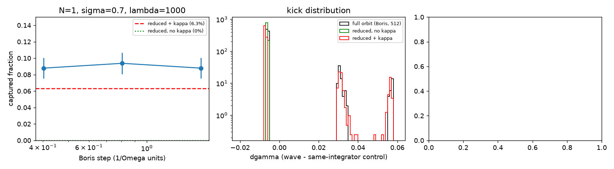
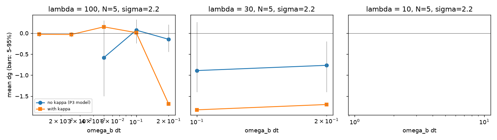
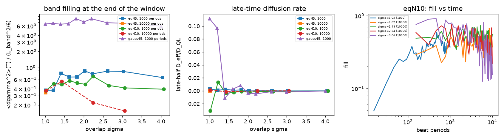
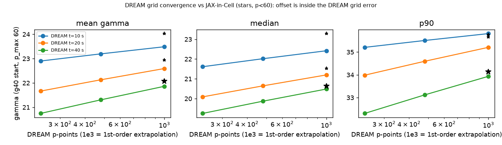

# Step 1 notes: closing the numerical questions of the runaway-helicon overlap study

Scripts: `scripts/` (JAX_ENABLE_X64=1 set before importing jax; the P2 Boris integrator `bw.py`, `plasma.py`, `theory.py`, `drift.py`, `exp.py` and the P3 `p3lib.py`, `runS_scan.py` are imported unchanged from `results/P2/scripts` and `results/P3/scripts`).
Data: `data/` (small, about 2 MB: pickles of per-particle kicks, logs, json). Figures: `figs/`. Nothing committed or pushed; nothing outside `results/step1/` was touched.
Hosts: laptop (at most 2 threads at a time, load 20-60 from other jobs) and office (about 12-16 single-thread processes, CPU only; the GPUs were busy). The office was oversubscribed by other users (load 45-65 on 36 cores), so long full-orbit runs there are slow; the laptop core is about 2.5 times faster per thread than a loaded office core.

## Verdicts

| # | Question | Verdict | Short answer |
|---|---|---|---|
| 1 | Passage disagreement, full orbit vs reduced | **Closed (cause found, reduced model fixed)** | The reduced model dropped the tangential term of the gyro-resonance, psi' += -kappa sin(psi), kappa = F b Omega / u_perp = 0.16 omega_b at sigma = 0.7. Without it there is no trapped branch (about 9% of the particles at N = 1, sigma = 0.7) and the rms is 1.5-2.2x too small at sigma <= 2.2, N = 1, 2, 5. With it, integrated by a second-order split, the reduced model reproduces the full-orbit rms to 4-14% and the captured fraction to 7.3% vs 9.4% (lambda = 1000). The P3 N = 1 full-orbit runs also used a 3x longer window than the reduced runs. Not a dt bias of the Boris run, not the kick definition. |
| 2 | Capture/drag at N = 5, sigma = 2.2 | **Closed for "every particle captured"; the weaker physical drag is real and sweep-independent; the physical sweep itself was not run** | "All captured, mean -1.55" at lambda = 100 was a non-converged result of the incomplete reduced model (mean -0.15, +0.07, -0.58 at omega_b dt = 0.2, 0.1, 0.05). Full orbit gives a systematic lag of the ensemble behind the control of -0.23 (all 16 particles lag, 5-95%: -0.4 to -0.1) at lambda = 100 (R = 3.5e3) and -0.24 at lambda = 1000 (R = 349), that is independent of the sweep rate over a decade and persists (-0.19) when the wave is switched on and off adiabatically. It is partial surfing of the comb (the lag is 0.8 of the 5-line band width of 0.29 in gamma), not locking of the whole ensemble and not diffusion. |
| 3 | Does the coherent-comb window close again above sigma 1.6-2.2? | **Closed; the answer is stronger than the question** | For a coherent finite comb diffusion is a transient at every sigma. The sigma above which D_eff/D_QL (whole window) falls below 0.3 moves down as the window grows: about 2.2 at 16 beat periods, 1.4-1.6 at 64 and 1.0-1.2 at 256 for N = 10 equal lines (Gaussian 4.5: 2.6, 1.8-2.2, 1.2-1.4). At 1e3 periods the ratio is below 0.03 for every sigma from 1.0 to 4 for N = 5 and 10, and at 1e4 periods for N = 10 at sigma = 1.0, 1.4, 2.2, 3.0; the Gaussian spectrum is below 0.05 above sigma = 1.2 at 1e3 periods and keeps 0.25 (late half 0.11) at sigma = 1.0. dt-converged. A perfectly coherent launch therefore gives bounded scattering at all amplitudes, and prediction (iii) holds only for dwell times of a few tens of beat periods. |
| 4 | Plateau 10% low | **Closed (explained)** | The deficit is the relaxation of the kick under the time-compressed drive between the crossing and the end of the window, partly offset by the pitch-spread normalisation. It scales as lambda^0.5 and is below 1% at the physical lambda = 1. |
| 5 | Mean-gamma offset vs DREAM | **Closed (bounded)** | The +3.6% at DREAM's finest grid is the size of DREAM's own grid error: refining p from 240 to 480 points moves its mean by +2.7%; a first-order Richardson step leaves +0.9%, a second-order one +2.7%. |

## Protocol changes used in every step-1 run (`scripts/pc2.py`, `scripts/pcommon.py`, `scripts/red_env.py`)

- One `setup()` builds the window, initial conditions and line phases once and hands them to both the full-orbit Boris integrator and the reduced model, so a comparison starts from the same state (same random draws as `runP.py` / `runPr.py`).
- The kick is defined with a control that uses the same integrator and the same drive (`g_wave - g_b0`). The P3 full-orbit passage used an RK4 control; the two controls agree to 4e-9 in gamma (lambda = 1000, N = 1), so the definition of the kick is not the cause of any disagreement below.
- Optional sin^2 amplitude ramp at both ends of the window and an `ic="cross"` option (control integrated backwards from the resonance). Both are off for the numbers compared with P3 unless stated.
- `red_env.py` is `P3/scripts/red.py` plus an amplitude envelope, switches for friction and radiation reaction, and the phase term `kappa` of section 1 (second-order split; the first-order variant is kept in `red_env_first_order.py`). `red_st.py` is a stationary reduced integrator with classical RK4 (section 3).
- "Beat period" means 2 pi / Delta_delta = 38 ns (Delta_delta = 1.67e8 /s at Delta k = 0.57 /m). P3's "beats" are 1/Delta_delta units, 6.3 times shorter: its 400-beat window is 64 beat periods and its minimum "10 beats" is 1.6 periods.

## 1. Passage disagreement at lambda = 1000

### What the disagreement consists of
At N = 1, sigma = 0.7, lambda = 1000, with window and initial conditions matched (`setup`, ramp 20/omega_b), the full-orbit kick distribution is bimodal. About 90% of the particles form a narrow bulk (median -0.00599, standard deviation 0.00026). The reduced model gives median -0.00602, standard deviation 0.00024, so the bulk agrees to 0.5%. The other 9% end at dg = bulk + 0.044. Their detuning stays within +-2 omega_b of the resonance for the whole second half of the window while the control runs away to +7.4 omega_b: they are trapped in the island and dragged along. The P3 reduced model has no such branch (0 of 4096 particles). The ensemble rms is set by this 9% (0.013 against 0.0003 for the bulk), which is the "factor 3 to 10" of P3.

### Ruled out
| candidate | test | result |
|---|---|---|
| definition of the kick (control integrator) | same-integrator control vs RK4 control, 64 particles | differ by 4e-9 in gamma |
| dt bias of the Boris run | N = 1, sigma = 0.7, dt = T_gyro/64, /128, /256 (steps per gyro-period 64, 128, 256), 4 seeds x 128 particles, same initial conditions | captured fraction 8.8%, 9.4%, 8.8%; offset 0.044, 0.043, 0.046; bulk -0.00599, -0.00600, -0.00601. In a first set (256 particles, one seed): 8.2, 7.4, 6.6, 5.5% at dt = T/16, /32, /64, /128, statistical error 1.7%. The per-seed fractions are the same at each dt (12.5, 12.5, 3.1, 7.0% at T/64 and 13.3, 13.3, 3.1, 7.8% at T/128), so the captured set is fixed by the initial conditions. |
| bug of the Boris integrator | independent RK4 integrator of the exact Lorentz-force ODE (Cartesian, dt = T_gyro/128), same 24 initial conditions, k_perp = 0 wave | 4 of 24 captured with RK4 (offset +0.06 to +0.086) and 4 of 24 with Boris (+0.045 to +0.067); different particles are captured (capture is sensitive to the integrator), the distributions agree. Same for N = 2, sigma = 0.7 (2 and 3 outliers). |
| dissipative terms | Boris, N = 1, sigma = 0.7, 256 particles: E_par only / + friction / + radiation reaction / all | captured 11.3 / 11.7 / 7.8 / 5.5%: capture exists with E_par alone |
| window mismatch of P3 (a real problem, separate) | `runP.py` sets `Dd = 1e9` for N = 1, so the N = 1 full-orbit window was +-5e8 rad/s while `runPr.py` used +-6 omega_b = 1.8e8 rad/s | Boris with the P3 window: rms 0.039 (mean +0.019); with the matched window 0.017 (mean -0.002; 32 particles). N = 2 and 5 had identical windows in P3 and are unaffected. |

### Cause: the reduced model drops the tangential term of the phase equation
For an electron in B0 plus a parallel circularly polarised wave (W = u_x + i u_y = rho e^{i phi}) the exact equations are
rho' = -E(1 - k v_z/omega) cos(psi), psi' = -delta(gamma, u_z) + [E(1 - k v_z/omega)/rho] sin(psi), du_z = (k/omega) dgamma
(from dW/dt = i W/gamma - E(1 - k v_z/omega) e^{i sigma Theta}; for k_perp = 0 nothing is averaged; the psi of the reduced model is this psi shifted by pi, which flips the sign convention of the sin term but not its physical content). The P3 reduced model integrates the amplitude equation and `psi' = -delta` only. The missing term is the Hamiltonian completion: with J = rho^2/2 the system is H = H0(J) + h(J) sin(psi), psi' = dH/dJ, and dropping dh/dJ makes the flow non-symplectic. Its size is kappa = F b Omega / u_perp (F the radial force amplitude per unit b of `theory.frad`, already in the reduced model). At sigma = 0.7 kappa = 4.7e6 /s = 0.16 omega_b. For the DIII-D line the tangential amplitude differs from the radial one by 4% (|S|/|R| = 0.96, arg = pi), so the same coefficient applies. I first estimated this term at 1% of omega_b; the exact expression gives 16%.

Adding `psi_c' -= sum_j kappa_j sin(psi_j)` to the reduced model (`red_env.Red`, `kappa = 1`) is enough. The term is integrated by Strang splitting (half step before the kicks, half after). A first-order version has an error that grows with the window (omega_b dt = 0.1, 0.05, 0.02, 0.01 gave an N = 2, sigma = 0.7 median of 0.0163, 0.0072, 0.0055, 0.0049 against 0.0041 from full orbit) and at lambda = 1 it fails completely (rms 0.53); the split version gives median 0.0038-0.0042 at omega_b dt = 0.1, 0.05, 0.02.

| test (lambda = 1000, same window and initial conditions) | full orbit (Boris) | reduced, no kappa | reduced + kappa (omega_b dt = 0.03 for N = 1, 0.05 otherwise) |
|---|---|---|---|
| N = 1, sigma = 0.7 (ramp 20/omega_b): rms | 0.0133 | 0.0061 | 0.0123 |
| same: captured fraction | 9.4% (512 particles) | 0% | 7.3% (4096) |
| same: median / 95th percentile | -0.0060 / 0.0308 | -0.0062 / -0.0058 | -0.0062 / 0.0299 |
| N = 2, sigma = 0.7: rms / median / 95th percentile | 0.0121 / 0.0041 / 0.0245 | 0.0058 / 0.0040 / 0.0068 | 0.0139 / 0.0041 / 0.0372 |
| N = 2, sigma = 1.4: rms / mean | 0.0359 / +0.0109 | 0.0359 / +0.0221 | 0.0339 / +0.0113 |
| N = 5, sigma = 1.2: rms / mean | 0.116 / -0.067 | 0.082 / -0.023 | 0.126 / -0.089 |
| N = 5, sigma = 1.6: rms / mean | 0.166 / -0.139 | 0.102 / -0.033 | 0.173 / -0.144 |
| N = 5, sigma = 2.2: rms / mean | 0.261 / -0.236 | 0.177 / -0.053 | 0.280 / -0.256 |
(Boris: 512, 128 and 64 particles for N = 1, 2, 5. Reduced: 4096, 1024 and 256 particles. `scripts/item1_final.py`, `data/item1_final.json`.)

Without kappa the rms is 1.5 to 2.2 times too small and the mean is 2 to 4 times off (N = 2, sigma = 1.4 excepted, whose rms agrees by chance). With it the rms agrees to 4-14% in all six cases and the means to 4-33% for N = 2 and 5 (N = 1: -0.0030 against -0.0019, a difference of 0.001). The residual of the N = 2, sigma = 0.7 case is the tail: the reduced model has a heavier upper tail (95th percentile 0.037 against 0.0245; 128 full-orbit particles). The same holds for a k_perp = 0 wave (checked for N = 1 and N = 5, sigma = 2.2: full orbit -0.231 with k_perp = 0 and -0.236 with the DIII-D polarisation).

### dt-halving and Richardson at sigma = 1.4
- Full orbit, N = 2, sigma = 1.4, lambda = 1000, dt = T/16, /32, /64 gyro-period (64 particles each): rms dg = 0.0354, 0.0353, 0.0373. No dt bias beyond 5%. At sigma = 0.7 the rms is 0.0139, 0.0166, 0.0110, 0.0078 for dt = T/16 ... T/128; the spread is the captured fraction (64 particles, 5-9%) and the bulk is converged.
- Reduced model with kappa, N = 2, lambda = 1 (physical sweep, R = 1.4e5 at sigma = 1.4): sigma = 1.4: omega_b dt = 0.4: rms 0.168 (mean -0.166); 0.2: rms 0.081 (mean +0.045); 0.1: rms 0.105 (mean +0.096, std 0.042). sigma = 0.7: omega_b dt = 0.2: rms 0.047 (mean +0.037); 0.1: rms 0.036 (mean +0.020). The kick is not converged at any of these steps: at sigma = 1.4 the mean goes -0.166, +0.045, +0.096 as the step is halved, so no Richardson extrapolation is possible. The error is the accumulated second-order error of the phase-exact kick scheme over 1e7 steps (P3 saw the same: 0.049 at omega_b dt = 0.15, 0.017 at 0.075, Richardson 0.0063 at sigma = 0.7 without kappa), and for the steps used here it exceeds the physical kick. A second-order Richardson step on the two finest steps gives a mean of +0.014 at sigma = 0.7 and is not meaningful at sigma = 1.4 (the 32-particle ensembles are also chaotic at R = 1.4e5). **I did not obtain a dt-converged physical-sweep (lambda = 1) value.** The error scales as (number of steps) x dt^2, so lambda = 1 needs omega_b dt <= 0.02, i.e. 1e8 steps per particle for N = 2, which was beyond the budget (the office was at load 60-100). At lambda = 1000 and 100 (R <= 3.5e3), where the steps are 1e3 times fewer, the reduced model with kappa agrees with full orbit as shown above.

### One full-orbit passage at lambda = 100 with a long window
N = 5, lambda = 100, 5.4e7 (sigma = 1.6) and 6.4e7 (sigma = 2.2) Boris steps per particle (about 40 times the window of the lambda = 1000 runs), 16 particles, abrupt switch-on as in P3:

| sigma | R | lambda = 100 rms / mean | lambda = 1000 rms / mean |
|---|---|---|---|
| 1.6 | 1.85e3 (185) | 0.1659 / -0.1412 | 0.1658 / -0.1394 |
| 2.2 | 3.5e3 (349) | 0.2497 / -0.2276 | 0.261 / -0.236 |
The two sweep rates give the same kick to 4%: the passage is adiabatic and R-independent already at R = 185-349 (details in section 2). The reduced model with kappa gives lambda = 100, sigma = 2.2: rms 0.32, 0.22, 0.30 and mean -0.27, -0.20, -0.28 at omega_b dt = 0.2, 0.1, 0.05 (32 particles; chaotic sensitivity of individual particles, so the 0.04 scatter between step sizes is sampling).

## 2. Capture / drag at N = 5, sigma = 2.2

### Reduced model of P3: the captured state is not converged
P3 reported mean dg = -1.55 (all captured) at lambda = 100. `scripts/item2.py` reruns it (window and initial conditions of P3, 48 particles):

| model | omega_b dt = 0.2 | 0.1 | 0.05 | 0.025 | 0.0125 |
|---|---|---|---|---|---|
| lambda = 100, P3 model (no kappa) | rms 0.28, mean -0.15 | 0.21, +0.07 | 0.95, -0.58 | | |
| lambda = 100, first-order kappa | 1.68, -1.68 | 0.05, +0.01 | 0.16, +0.15 | 0.05, -0.03 | 0.06, -0.03 |
| lambda = 100, split kappa (32 particles) | 0.32, -0.27 | 0.22, -0.20 | 0.30, -0.28 | | |
| lambda = 30, P3 model | 0.93, -0.77 | 1.12, -0.89 | | | |
| lambda = 30, split kappa | 0.44, -0.41 | 0.26, -0.23 | 0.23, -0.20 | | |
| lambda = 10, split kappa | 0.50, -0.46 | 0.19, -0.15 | (not finished) | | |

The P3 model changes by an order of magnitude between omega_b dt = 0.2, 0.1 and 0.05, so the -1.55 is one point of an unconverged scatter. The all-captured values (mean -1.7 to -1.8, 5-95% range 0.03) come only from the first-order kappa at the coarsest steps; with the split scheme the reduced model at lambda = 100 gives -0.20 to -0.28 at all three steps. The statement "every particle is captured at lambda = 100 and none at lambda = 1000" is withdrawn.

### Full orbit
| sigma | lambda = 1000 (64 particles) | lambda = 100 (16 particles) |
|---|---|---|
| 1.2 | rms 0.116, mean -0.067 | |
| 1.6 | 0.166, -0.139 | 0.166, -0.141 |
| 2.2 | 0.261, -0.236 (k_perp = 0: 0.257, -0.231; 16 particles abrupt: 0.280, -0.258) | 0.250, -0.228 |
- All particles lag the control (16 of 16 at lambda = 100; 5-95% range -0.42 to -0.095 at sigma = 2.2), and the lag grows with b: -0.067, -0.139, -0.236 at sigma = 1.2, 1.6, 2.2. The 5-line comb spans 0.29 in gamma (P3: band-fill rms 0.118 = L_c/sqrt(6)), so the lag is 0.5 of the comb width at sigma = 1.6 and 0.8 at sigma = 2.2.
- It is not an end-of-window artefact: with sin^2 ramps of 30/omega_b at both ends (lambda = 1000, 16 particles, sigma = 2.2) the mean is -0.193 and the rms 0.210, against -0.258 and 0.280 for the abrupt run of the same particles. The reduction by a quarter is the adiabatically removed quiver; three quarters remain.
- It does not depend on the sweep rate between R = 349 and R = 3.5e3 (4% in rms at sigma = 1.6, 2.2) and, in the reduced model, between R = 3.5e3 and R = 3.5e4 (lambda = 100, 30, 10: mean -0.20 to -0.28, -0.20 to -0.23, -0.15 at omega_b dt = 0.05-0.1; the omega_b dt = 0.2 values -0.27, -0.41, -0.46 are not converged).
- The split-kappa reduced model reproduces it at lambda = 1000: mean -0.256 against -0.236, rms 0.280 against 0.261.

### Reading
- Phase locking of the whole ensemble to the comb ("captured and dragged by 1.55") is an artifact of the incomplete, non-converged reduced model.
- The physical effect is a net, deterministic energy loss of the particles in the passage through a strongly overlapping coherent comb: dg = -0.14 at sigma = 1.6 and -0.23 at sigma = 2.2 (0.07 and 0.12 MeV for gamma about 16), 0.5-0.8 of the comb width, with a 5-95% spread about the mean of +-0.17 at sigma = 2.2. Individual particles are partly dragged along the chain of islands and released, and the net displacement is sweep-independent. For a single line (N = 1) the same effect is a 9% trapped branch with a net mean of -0.002 and a bulk shift of -0.006.
- At the physical sweep (lambda = 1, R = 3.5e5 at sigma = 2.2) a full-orbit run needs 6e9 steps per particle, which I did not run. The sweep-independence over R = 349-3.5e3 in full orbit and over R = 3.5e3-3.5e4 in the reduced model says the physical value is the same lag, about -0.23 at sigma = 2.2 for a coherent five-line comb. This is a bounded statement: an extrapolation over two more decades in R.
- Implication for the program: in the passage protocol coherent overlap at sigma >= 1.6 acts as a net energy drag on the passing runaway, not as diffusion; the P3 statement that the kick in a passage 'does not follow QL and is bounded by island and band size' stands, with the added result that its mean is not zero.

## 3. Does the coherent comb close again at large sigma?

Method (`scripts/red_st.py`, `st_batch.py`, `table_item3.py`): the stationary protocol of P3 (no drive, no collisions; particles uniform in gamma over the line band, theta0 = 0.2 +- 0.01, random gyrophase and z), with the same reduced equations including kappa, but integrated by classical RK4 with a step set by the fastest line phase rate (dt = 0.1 / ((N_lines + window)/2 Delta_delta + 4 omega_b)). The P3 reduced integrator damped numerically beyond 1e3 beats; RK4 does not at these windows. D_eff/D_QL is the slope of <dg^2> over the stated part of the window divided by the P3 D_QL (stationary-phase rate over the window of 5 lines for the Gaussian, all lines for the equal-line combs). Windows are in beat periods (2 pi / Delta_delta). Equal-line combs N = 5 and 10, Gaussian 4.5 (25 lines).
Convergence (kappa = 0 runs, N = 10, 1e3 periods, step factor 0.2 / 0.1 / 0.05): late-half D/D_QL +0.002, -0.001, -0.003 at sigma = 1.4 and 0.000 at all three at sigma = 2.2; band filling 0.26, 0.24, 0.27 and 0.08, 0.08, 0.08. At sigma = 1.4 and below individual trajectories are chaotic, so only ensemble averages converge (64-384 particles per point, up to 4 seeds). Sampling error on D_eff/D_QL at the onset is about 0.1-0.2 (window 16-64 periods).

D_eff/D_QL over the whole window [0, T], N = 10 equal lines, with kappa (`data/item3_tables.md` has all tables, with and without kappa, whole window and late half):

| beat periods T | sigma = 1.0 | 1.2 | 1.4 | 1.6 | 1.8 | 2.0 | 2.2 | 2.6 |
|---|---|---|---|---|---|---|---|---|
| 16 | 0.35 | 1.24 | 1.61 | 1.10 | 0.95 | 0.56 | 0.29 | 0.07 |
| 64 | 0.62 | 0.84 | 0.37 | 0.26 | 0.10 | 0.02 | 0.02 | 0.00 |
| 256 | 0.32 | 0.09 | 0.08 | 0.01 | 0.00 | 0.00 | 0.00 | 0.00 |
| 1000 | 0.03 | 0.01 | 0.00 | 0.00 | 0.00 | 0.00 | 0.00 | 0.00 |
At 1e4 periods (N = 10, 32 particles): 0.00 at sigma = 1.0, 1.4, 2.2 and 3.0. Late half [T/2, T], 1e3 and 1e4 periods: |D/D_QL| <= 0.03 at every sigma tested (eqN10: all ten sigma from 1.0 to 4.0 at 1e3 and sigma = 1.0, 1.4, 2.2, 3.0 at 1e4 with values -0.001 to 0.001 and band filling 0.37, 0.55, 0.22, 0.16; eqN5: all ten sigma at 1e3, values 0.00 to 0.01).

Findings.
1. The diffusive window is a transient. The sigma above which D_eff/D_QL (whole window) falls below 0.3 moves from about 2.2 at 16 periods to 1.4-1.6 at 64 and 1.0-1.2 at 256, and at 1e3 periods the ratio is below 0.03 at every sigma including 1.0. So for the equal-line combs the answer to "does it close above sigma about 1.6-2.2" is: it closes there within tens of periods, and it closes at every sigma within a few hundred. Windows of 1e3 and 1e4 periods give zero late-time diffusion everywhere.
2. The saturation is partial filling, not equilibrium mixing: <dg^2>(T) reaches 0.1-0.6 of L_band^2/6 (the value for complete mixing over the comb) and stays there to 1e4 periods (heavy-tailed for the Gaussian spectrum, where 32-64 particles give a noisy value). That is the signature of a bounded chaotic region in a two-degree-of-freedom Hamiltonian system (a finite coherent comb is autonomous in the wave frame, so there is no asymptotic diffusion). Phase noise, damping or a second source line breaks this, which agrees with P3's finding that 3 MHz of phase noise removes the threshold.
3. The Gaussian comb (25 lines, sigma at the centre) behaves the same way with the closing sigma shifted up by 0.2-0.4 relative to the equal-line combs (not isolated; the line amplitude falls from the centre outwards, so the local sigma does too). With kappa, whole window: D/D_QL is above 1 for sigma = 1.2-2.2 at 16 periods (0.27 at 2.6); at 64 periods 1.01, 1.69, 1.27, 0.69, 0.30, 0.33, 0.18 for sigma = 1.0, 1.2, 1.4, 1.6, 1.8, 2.0, 2.2; at 256 periods 0.73, 0.54, 0.16, 0.08, 0.03, 0.00 for sigma = 1.0 ... 2.0, so only sigma <= 1.2 is still diffusing. At 1e3 periods: 0.25, 0.05, 0.02, 0.00 for sigma = 1.0, 1.2, 1.4, 1.6 and about zero above (late half 0.11, 0.10, -0.01 for sigma = 1.0, 1.2, 1.4). Without kappa sigma = 1.4 gives -0.002 at 1e4 periods; no kappa run of the Gaussian spectrum at 1e4 finished.
4. kappa changes the early window only: at 16 periods the diffusive window extends to larger sigma with kappa (0.56 at sigma = 2.0, 0.29 at 2.2 for N = 10) than without (0.00, 0.04). The late-time result (zero diffusion at >= 1e3 periods) is the same with and without kappa.

Consequence for prediction (iii) (CW power scan shows an enhanced-scattering window at b = 1-5e-4): for a perfectly coherent comb the enhancement exists only while the dwell time is shorter than about 16-256 beat periods (0.6-10 microseconds) depending on sigma; for the physical dwell of 1e6 periods the coherent comb gives bounded scattering at every power, so a power-scan window of enhanced scattering followed by a rollover cannot be claimed for a coherent launch at long dwell. What survives is the bounded spread itself (about 0.2-0.6 of the full-mixing value over the comb), against unbounded diffusion once phase noise is present.

## 4. Plateau deficit below the P2 crossover

P2 found D_eff/D_QL = 0.9 (0.87 at lambda = 1000) for R = omega_b^2/|d delta/dt| < 1 and could not explain it. `scripts/plateau2.py` takes a single line in the linear regime (R = 0.03-0.3), the P2 window X = 10 sqrt(A), and compares four quantities particle by particle: (a) the measured <dg^2> at the end of the window, (b) the P2/P3 stationary-phase value with F, G, A at the nominal (starting) pitch, (c) the same with each particle's own state at its resonance crossing, (d) the full linear response integral 1/2 |int c(t) exp(-i Phi(t)) dt|^2 along the actual control orbit (windowed Fresnel integral). Reduced model; ensemble of 64.

| case (single line, linear regime) | measured / QL(nominal) | QL(local) / QL(nominal) | linear response / QL(local) | measured / linear response |
|---|---|---|---|---|
| lambda = 100, X = 10 sqrt(A), theta0 in [0.1, 0.3] (P2 ensemble) | 1.005 | 1.078 | 0.997 | 0.935 |
| lambda = 100, X = 20 sqrt(A) | 0.909 | 1.074 | 0.995 | 0.850 |
| lambda = 100, X = 40 sqrt(A) | 0.808 | 1.067 | 0.998 | 0.759 |
| lambda = 300, X = 10 sqrt(A) | 0.954 | 1.075 | 0.996 | 0.891 |
| lambda = 1000, X = 10 sqrt(A) | 0.833 | 1.070 | 0.994 | 0.783 |
| lambda = 100, X = 10 sqrt(A), theta0 = 0.2 +- 0.01 | 0.820 | 0.998 | 0.945 (64 particles) | 0.869 |
| lambda = 100, X = 40, E_par only | 0.938 | 0.999 | 0.998 | 0.940 |
| lambda = 100, X = 40, E_par + friction | 1.090 | 0.998 | 1.005 | 1.087 |
| lambda = 100, X = 40, E_par + radiation reaction | 0.848 | 1.058 | 1.000 | 0.801 |

Findings.
1. The window truncation is not the cause: the linear response over the actual windowed orbit is 0.99-1.00 of the local stationary-phase value (the Fresnel tails of a 10-40 sqrt(A) window are below 1% for the 64-particle averages; the 64-particle single-pitch case shows 0.945, within its sampling error).
2. The measured end-of-window kick is smaller than the linear response by 6.5% (lambda = 100, X = 10 sqrt(A)), 15% (X = 20), 24% (X = 40), 11% (lambda = 300) and 22% (lambda = 1000). This grows with the time between the crossing and the end of the window and with lambda. The reduced and full-orbit runs both include the drive acting on the displaced particle: the kick changes u_perp (a gamma kick of 0.01 is accompanied by du_z = 4 dgamma and a 15% change of u_perp^2), the pitch-dependent radiation reaction and friction then relax the displacement. The dependence on the drive terms confirms it (X = 40, lambda = 100: E_par only 0.94, +friction 1.09, +radiation reaction 0.80, all terms 0.76). The relaxation rate is proportional to lambda while the time after the crossing is proportional to 1/sqrt(lambda), so the deficit goes as lambda^0.5 (6.5%, 11%, 22% at lambda = 100, 300, 1000 for X = 10 sqrt(A): exponent 0.53) and is about 0.7% at lambda = 1. The P2 plateau is therefore partly a time-compression artefact and the physical plateau is 1.0 within a percent.
3. The stationary-phase value evaluated at the starting pitch underestimates the local rate by 7-8% for the wide pitch ensemble [0.1, 0.3] (QL(local)/QL(nominal) = 1.07-1.08: the kick is evaluated at the crossing pitch and A differs by 1.4%), which compensates part of finding 2 and is why the P2 ratio sits near 0.9 rather than 0.8.

Bound: for the P2 window (X = 10 sqrt(A), wide pitch ensemble) the reduced model gives measured/QL(nominal) = 1.00, 0.95, 0.83 at lambda = 100, 300, 1000, consistent with P2's 0.87-0.9 at lambda = 30-1000 (P2 used the xi metric and Boris, so the match is in magnitude and trend, not exact). The explanation is the sum of the relaxation (finding 2) and the normalisation (finding 3); neither is a property of the underlying resonance, and the plateau tends to 1.0 as lambda -> 1. Not simulated directly at lambda = 1: for R < 1 at lambda = 1 the full orbit needs more than 1e9 steps per particle.

## 5. Mean-gamma offset against DREAM

DREAM has two grids with the same g40 start and p_max = 60 (b_m1: 240 p-points, b_m2: 480) and two with a fixed-point start and p_max = 40 (b_fp_L1: 240, b_fp_L2: 360). P1 compared the JIC stationary mean with the DREAM p_max = 40, 360-point value (20.07). `scripts/item5_mean_gamma.py` compares time-matched g40-start JIC snapshots (7 independent JIC runs, 75776 particles, p < 60, which holds 99.8% of them at 40 s) with the DREAM pair.

| t (s) | DREAM 240 | DREAM 480 | DREAM 1st-order Richardson | DREAM 2nd-order | JIC (p < 60) | JIC / DREAM 480 | JIC / R1 | JIC / R2 |
|---|---|---|---|---|---|---|---|---|
| 20 | 21.67 | 22.13 | 22.59 | 22.28 | 22.95 | +3.7% | +1.6% | +3.0% |
| 40 | 20.75 | 21.31 | 21.86 | 21.49 | 22.07 | +3.6% | +0.9% | +2.7% |
Median: +3.8% / +0.7% / +2.8% at 40 s; p90: +3.1% / +0.6% / +2.2%. Fixed-point start, p_max = 40 (DREAM 240 vs 360 points): mean 19.81 vs 20.07 at 100 s; Richardson 20.58 (1st order) or 20.28 (2nd order); JIC truncated at p < 40 gives 20.9, i.e. +1.5% / +3.0%.

Doubling the DREAM momentum resolution (upwind advection, first-order accurate) raises the mean by 2.7% at 40 s and 2.1% at 20 s, which is of the size of the offset. With only two grids the convergence order cannot be measured. The offset is therefore +0.9 to +2.7% after allowing for DREAM's own convergence, from first- and second-order extrapolation; the delta-function JIC seed (DREAM seeds with sigma_theta = 0.03 lose 21% faster initially) and the absorbing wall at p_max are unmodelled and each acts in the right direction. **Closed as bounded: the +4-5% of P1 is not evidence of a JIC error.** A third DREAM grid is the only way to tighten it, and DREAM cannot be rebuilt.

## Limits and what is open
1. Item 1: the reduced model with kappa reproduces full orbit at lambda = 1000 (N = 1, 2, 5) and for the lambda = 100 N = 5 kick, to 4-14% in rms; the physical-sweep (lambda = 1) reduced result is not converged in dt, and no full-orbit run exists at lambda = 1 (N = 2: 3.4e9 steps per particle). The N = 2, sigma = 0.7 upper tail is 50% heavier in the reduced model. A guiding-centre phase term for oblique waves (k_x rho = 0.3) was not added.
2. Item 2: full orbit at lambda = 100 uses 16 particles and one seed. The reduced model at lambda = 10 and 30 is converged only to the level of the 0.05 scatter between omega_b dt = 0.1 and 0.05. The physical lambda = 1 sweep was not simulated; the statement for it is an extrapolation in R over two decades.
3. Item 3: coherent finite combs (random fixed line phases, one realisation per seed), cold-plasma fast-wave polarisation at n_e = 0.8e19, no drive. The 1e3 period results use 64-384 particles per point (eqN5, eqN10 and the Gaussian spectrum complete for ten sigma), the 1e4 results 32 particles at four sigma for N = 10 (kappa = 1) and one sigma for the Gaussian spectrum (kappa = 0 only); eqN5 and Gaussian runs at 1e4 with kappa did not finish. The reduced stationary model has no full-orbit check at 1e3 periods (impossible: 3e7 Boris steps per particle times 10 lines is feasible but was not run; P3 validated it against Boris to 10% in sigma_c at 10-400 1/Delta_delta units).
4. Item 4: reduced model in the linear regime (R = 0.03-0.3) at lambda = 100-1000; the lambda = 1 deficit (below 1%) is an extrapolation of the lambda^0.5 trend.
5. Item 5: only two DREAM grids per configuration, so the convergence order is assumed (first or second).
6. Hosts: the office was at load 45-100 throughout, so long office runs were slow and several planned runs (full orbit at lambda = 30, 10; reduced lambda = 1 at omega_b dt = 0.05) were stopped. Nothing else was left running except possibly background jobs listed below.

## Files
- `scripts/`: `pcommon.py`, `pc2.py` (matched Boris / reduced passage set-up), `borisrun.py`, `redrun.py`, `redcmp*.py`, `item1_final.py`, `item2.py`, `red_env.py` (reduced model with envelope, drive switches, kappa; `red_env_first_order.py` is the first-order variant), `red_st.py` + `st_batch.py` + `table_item3.py` + `analyze_item3.py` (item 3), `plateau2.py` (item 4), `item5_mean_gamma.py` (item 5), diagnostics `diag1.py`, `trace1.py`, `trace2.py`, `para*.py`, `para_rk4*.py`, `linresp.py`.
- `data/`: `item1_final.json`, `item1_final.log`, `item2_*.log/.pkl`, `item3_tables.md`, `item3_summary.json`, `item4_plateau.txt`, `item5_mean_gamma.json`, `s1/` (per-particle kick pickles of every Boris and reduced run and the logs; about 1 MB).
- `figs/`: `item1_capture_branch.png`, `item2_dt_convergence.png`, `item3_closing.png`, `item5_dream_grid_convergence.png`.
